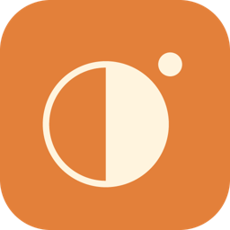
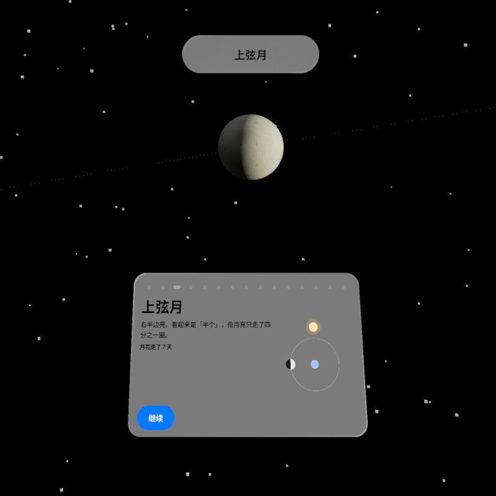
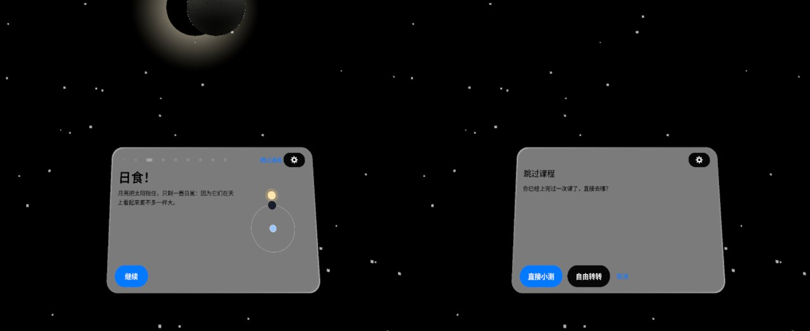
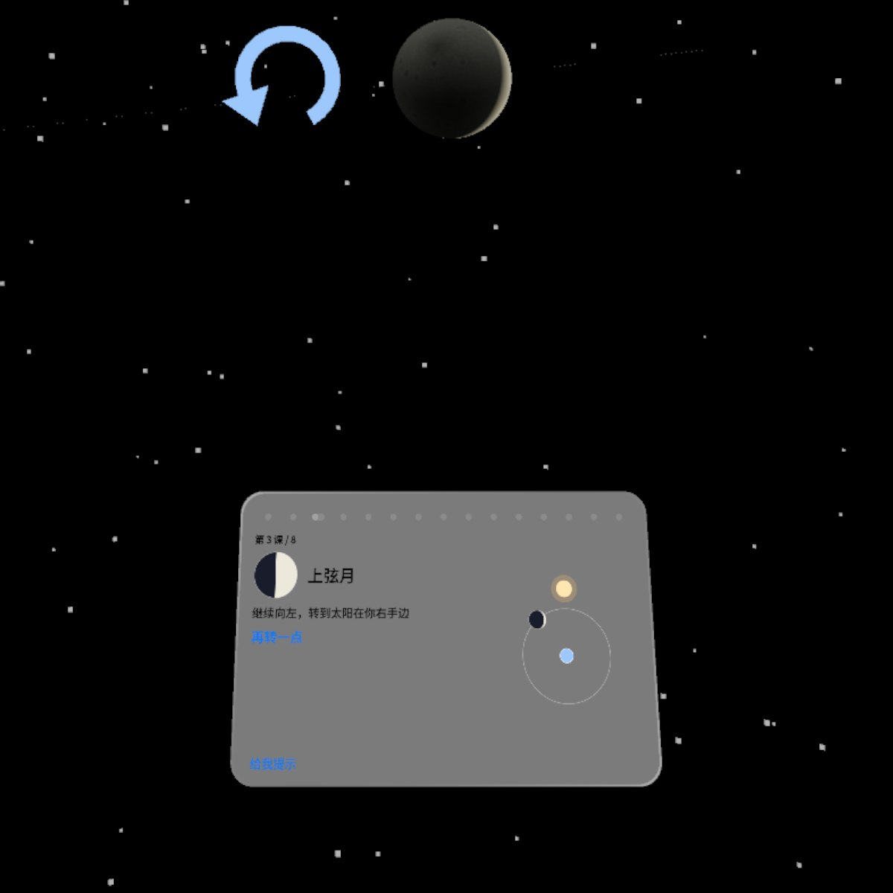
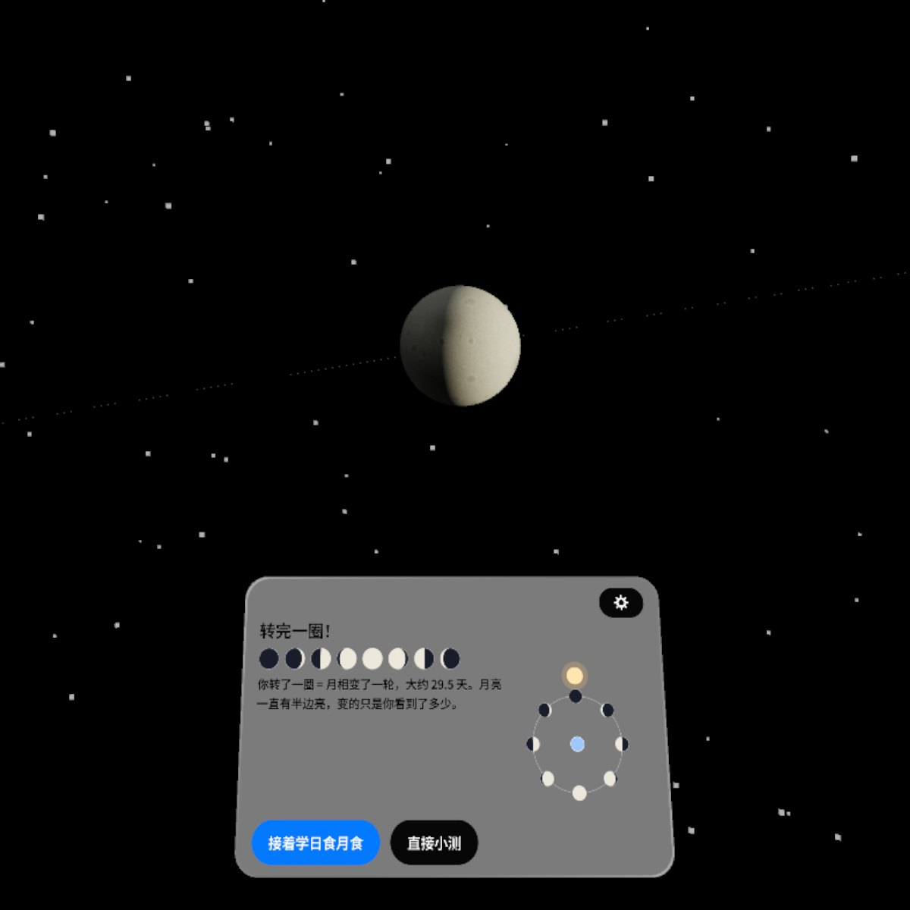
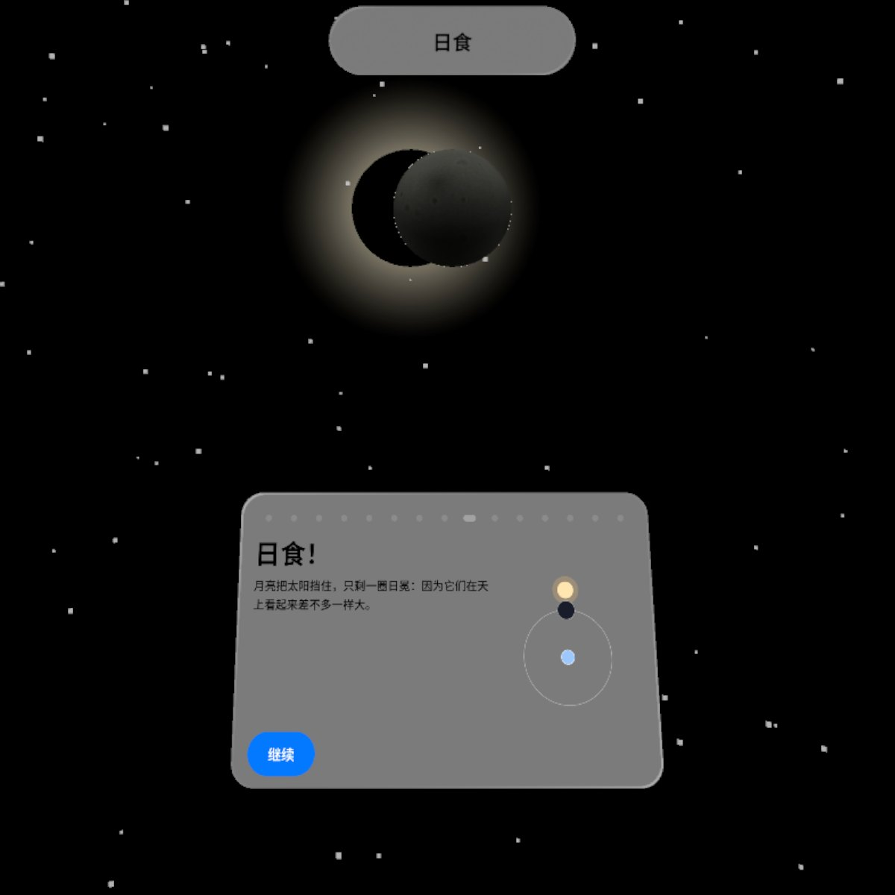
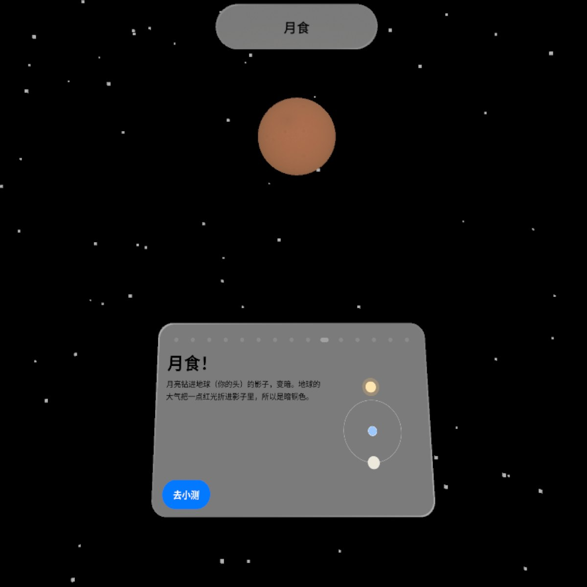
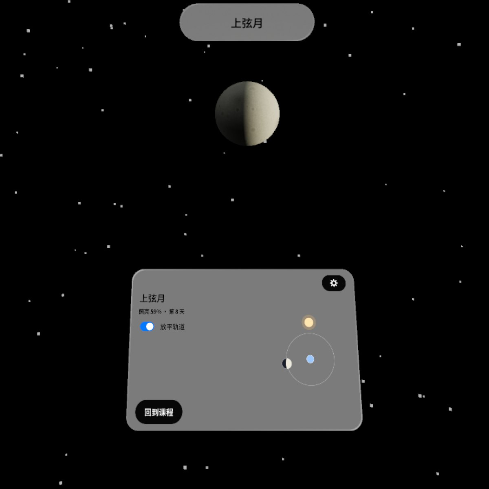
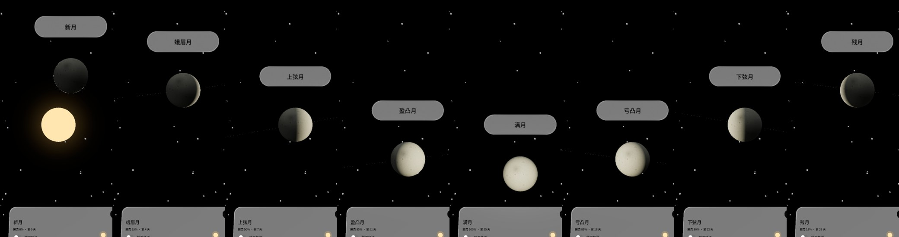
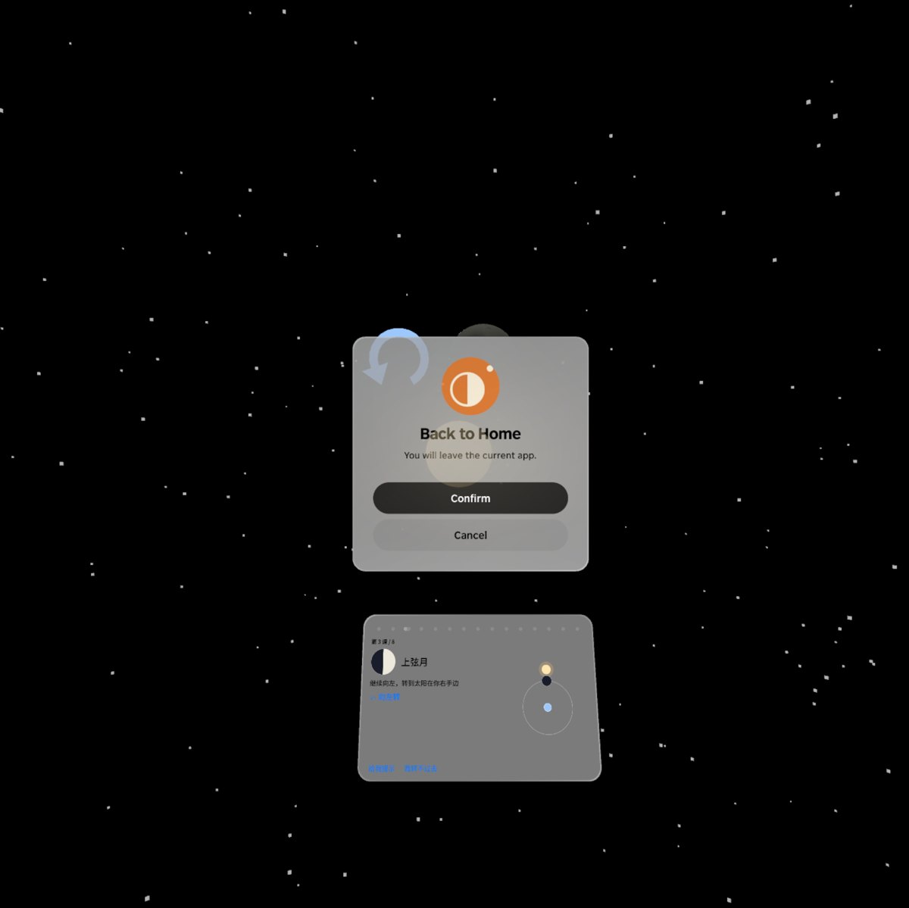

<p align="center"></p>

# Moon Phases | 月相课

**你就是地球：面前一盏太阳灯、眼前一颗月亮，原地往左转一圈，八个月相一格一格亮，再学日食月食，5 道小测下课。**

**You are the Earth: a sun lamp ahead of you and the Moon at arm's length. Turn left on the spot and the eight phases light up one by one; then learn the solar and lunar eclipse, and finish with a five-question quiz.**

PICO OS 6 · PICO Spatial SDK 6.1.9 · Kotlin / SpatialUI · package `io.embodit.moonphases` · v0.1.1

> **模拟器 QA 通过；v0.1.0 已在 PICO 头显上试用认可（Simulator-QA passed; v0.1.0 was tried and approved on a PICO headset）。**



> 截图和演示视频来自原生模拟器（PICO Emulator 6.1），由调试广播和模拟器相机转动代替真人转身；**非真实手势录像**。
> Screenshots and the demo video were taken on the native PICO emulator, driven by debug broadcasts and by turning the emulator camera instead of a real person turning; **not a recording of real hand gestures.**

---

## 中文

### 这是什么

一堂关于月相的小课。打开后四周变成星空，正前方 4 米处有一盏太阳灯，伸手的距离外有一颗月亮，你的头就是地球。课本卡告诉你这一课要找哪个相、该往哪边转；原地往左转，月亮跟着你的头绕一圈，被太阳照亮的那一面在你眼里从新月变成蛾眉月、上弦月、盈凸月、满月……转到位就判定「找到了」，并解释为什么是这个样子。

转完一圈后，放平月亮轨道去找日食和月食：日食时太阳被月亮挡住、日冕亮起，月食时月亮变成暗铜色。最后 5 道小测（转身作答和选择题），答对答错都有解释。也可以随时进入「自由转转」，看当前相名、照亮百分比和第几天。中英双语，不联网，不需要任何权限。

### 安装与启动

```bash
adb install -r MoonPhases-v0.1.1.apk
pico-cli app launch io.embodit.moonphases
```

APK 在 [Releases](https://github.com/kejing-dev/MoonPhases/releases) 页面下载（仓库不含 APK）。需要 PICO OS 6 头显或 PICO Emulator 6.1。APK 约 45 MB（内含完整中文字体）。原地转身前先看看四周有没有障碍物。

### 0.1.1 新增：上完一次后可跳过课程

第一次打开要完整走一遍课程。上完过一次（到过结课页，本地记住）以后，从开始页到日食月食的每一节，卡片右上角（设置键左边）都有「跳过课程」，点了选「直接小测」或「自由转转」；小测中右上角有「回到课程」，自由转转里也有「回到课程」按钮。另外修了 0.1.0 一个布局问题：上课和小测时 15 个进度点占满整行，把设置键挤没了，现在设置键一直在。



> 从 v0.1.0 升级：0.1.0 的 APK 是另一台电脑签的名，`adb install -r` 会报签名不一致，要先 `adb uninstall io.embodit.moonphases` 再装（会清掉已学进度和最好成绩）。

### 容器与骨架

- **容器**：默认 Stage，**渐进沉浸**（`STAGE_PROGRESSIVE`，启动沉浸度 100，可调范围 50–100），没有窗口容器。要用你的头部朝向判断你转到了哪个相，太阳和月亮要摆在你身边的真实空间里，所以是全空间应用。
- **骨架 C**：Stage + 头部位姿（HMDTrackingProvider）+ 一张跟随的课本卡和设置弹层；月相、日月食、小测的判定都在纯 Kotlin 的 domain 层（朝向角、四元数、弹簧插值），场景按帧排队建好太阳、月亮等 11 个资源。
- **状态**：设计包 16 个状态（S00–S15）加 3 个修饰状态，全部可由调试广播直接跳转并截图，结构见 [AGENTS.md](AGENTS.md)。

### 截图

| | |
|---|---|
|  |  |
| 找相 — 第 3 课 / 8「上弦月」，箭头提示往哪转 | 转完一圈 — 8 个相 + 29.5 天说明 |
|  |  |
| 日食 — 太阳核心被挡住、日冕亮起 | 月食 — 月亮变暗铜色 |
|  |  |
| 自由转转 — 相名、照亮 %、第几天 | 8 个相：自由转 0°、45° … 315° |

启动器图标：



### 已知问题（QA 第 1 轮，不影响使用）

- 按 HOME 退出再回来后，系统把沉浸度降到约 37，下方露出房间地板，比设计写的最低 50 还低；内容照常，可以自己调回去。
- 设置弹层刚弹出时下半截黑半秒，然后正常。
- 空闲模拟器上首次打开约 35 秒才把太阳、月亮全部建好（资源排队生成，防「没有响应」），头显上会快很多。
- 小测答错时红色「正确答案是…」在灰色玻璃上对比偏弱；一圈完成时地上 8 个刻度一起亮，没有依次闪。

还没在头显上验过：真人原地转身的手感和判定稳定性（模拟器用相机转动代替，判定是对的）、只有一盏太阳光时月亮背光面暗不暗、捏住月亮不放（定住月亮）、提示音、课本卡跟着大幅转身走的效果。

---

## English

### What it is

A short lesson on the phases of the Moon. The room turns into a starfield, a sun lamp sits 4 m ahead and the Moon floats at arm's length; your head is the Earth. The lesson card says which phase to find and which way to turn. Turn left on the spot and the Moon circles with your head; the sunlit half you see goes from new moon to waxing crescent, first quarter, waxing gibbous, full moon and on. When you reach the right angle the app marks it found and explains why it looks that way.

After a full lap, flatten the Moon's orbit to find a solar and a lunar eclipse: the Moon covers the Sun and the corona lights up, or the Moon turns a dark copper colour. The lesson ends with a five-question quiz (turn-to-answer and multiple choice), each answer explained. A free-turn mode shows the current phase name, percent illuminated and day of the cycle. Chinese and English, offline, no permissions.

### Install and launch

```bash
adb install -r MoonPhases-v0.1.1.apk
pico-cli app launch io.embodit.moonphases
```

Download the APK from the [Releases](https://github.com/kejing-dev/MoonPhases/releases) page (the repository itself does not ship an APK). Needs a PICO OS 6 headset or PICO Emulator 6.1. The APK is about 45 MB because it bundles the full Chinese font. Check the space around you before turning on the spot.

### New in 0.1.1: skip the lesson after the first time

The first run walks through the whole lesson. Once you have finished it (reached the score page; remembered on the device), every card from the start page through the eclipses shows "Skip the lesson" at the top right, next to the settings key, offering "Straight to the quiz" or "Free turning"; during the quiz the same corner has "Back to the lesson", and free turning keeps its "Back to the lesson" button. Also fixed from 0.1.0: during the lesson and the quiz the 15 progress dots filled the whole row and pushed the settings key off the card; it is always there now.


> Upgrading from v0.1.0: that APK was signed on another machine, so `adb install -r` fails with a signature mismatch. Run `adb uninstall io.embodit.moonphases` first (this clears learned phases and the best score).

### Container and skeleton

- **Container**: the default Stage with **progressive immersion** (`STAGE_PROGRESSIVE`, launched at immersion 100, adjustable 50–100), no window container. The app reads your head direction to know which phase you face, and places the Sun and Moon in the space around you, so it runs in Full Space.
- **Skeleton C**: Stage + head pose (HMDTrackingProvider) + a following lesson card and a settings popup; phase, eclipse and quiz logic lives in a pure Kotlin domain layer (headings, quaternions, spring smoothing); the Sun, the Moon and the rest of the 11 scene resources are built in a per-frame queue.
- **States**: 16 designed states (S00–S15) plus 3 modifiers, each reachable by a debug broadcast and captured; see [AGENTS.md](AGENTS.md).

### Screenshots

See the table above: seeking a phase, a completed lap, solar eclipse, lunar eclipse, free-turn mode, and the eight phases side by side.

### Known issues (QA round 1, none blocking)

- After leaving with HOME and coming back, the system drops immersion to about 37 and the room floor shows below, under the design's minimum of 50; content still works and you can raise it again.
- The settings popup shows a black lower half for half a second when it opens, then draws normally.
- On an idle emulator the Sun and Moon take about 35 s to be built on first launch (resources are queued to avoid "not responding"); a headset is far faster.
- On a wrong quiz answer the red correct-answer line has weak contrast on the grey glass; at the end of a lap the eight floor ticks light together instead of one by one.

Not yet verified on a headset: how turning on the spot feels and how stable the detection is (the emulator turned its camera instead, and detection was correct), how dark the Moon's night side looks with a single sun light, pinch-and-hold to freeze the Moon, the chime, and how the lesson card follows large turns.

---

## License

Source code © 2026 Embodit. All rights reserved (private repository). Bundled fonts Noto Sans / Noto Sans SC are under the SIL Open Font License (`app/src/main/assets/fonts/OFL-*.txt`).
